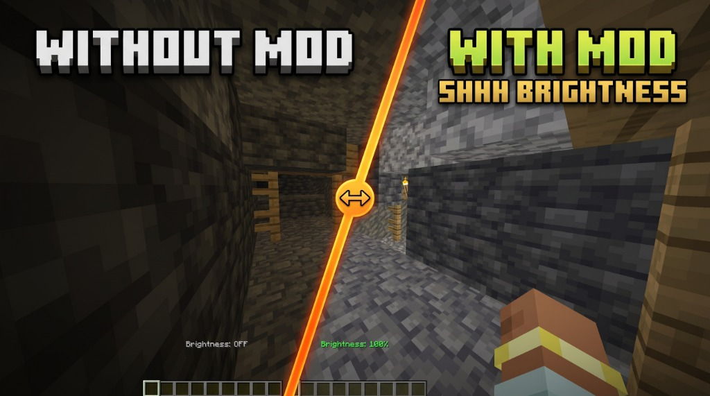

<div align="center">


# ☀️ Shhh... Brightness Toggle

**A lightweight, shader-native brightness & fullbright mod for Minecraft 26.3 on Fabric.**

[](https://minecraft.net/)
[](https://fabricmc.net/)
[](https://adoptium.net/)
[](LICENSE)
[](https://github.com/rafayshhh/shhh-brightness-toggle)

<br/>

*Illuminate dark caves and underwater depths cleanly with dynamic color feedback — zero fake potion swirls, zero HUD icons, zero clutter.*

</div>

---

## 📸 Showcase & Visual Comparisons

### 1. In-Game Visibility Comparison
Never lose your way in pitch-black mineshafts and caves again. The mod directly adjusts ambient illumination without altering your gamma preferences permanently:

<p align="center">
  
  <br/>
  <em>Side-by-side comparison: Pitch-black cave (Left) vs. Clean, illuminated cave with Shhh... Brightness Toggle at 100% (Right).</em>
</p>

### 2. Built-In Settings Screen (Mod Menu Integration)
Fine-tune your experience using an intuitive in-game menu featuring an on/off toggle, dynamic color slider, and message color switch:

<p align="center">
  
  <br/>
  <em>Configure fullbright state, percentage stepping, and dynamic color indicators directly from Mod Menu.</em>
</p>

### 3. Fully Rebindable Keybindings
Control your brightness on the fly without pausing your gameplay:

<p align="center">
  
  <br/>
  <em>Quickly rebind Toggle, Increase, and Decrease hotkeys to your favorite keys or mouse buttons.</em>
</p>

---

## ✨ Features

- 💡 **Instant Fullbright Toggle**: Toggle maximum visibility on and off with a single keypress (Default: <kbd>B</kbd>).
- 🎚️ **Fine-Grained Level Stepping**: Adjust brightness from 10% to 100% in 10% steps using <kbd>↑</kbd> *(Up Arrow)* and <kbd>↓</kbd> *(Down Arrow)*.
- 🎨 **Dynamic Color Feedback**: Actionbar notifications and settings slider labels shift colors smoothly based on brightness level (Vibrant Red at 10% ➔ Golden Yellow at 55% ➔ Clean Soft Green at 100%).
- 🛡️ **Shader-Native Illumination**: Modifies Minecraft 26.3's native lightmap shaders directly. No Night Vision potion icons, no swirling particles, and no blindness flashing.
- 🔄 **Safe Gamma Preservation**: Remembers your true vanilla brightness setting and restores it automatically when toggling off, disconnecting from a server, leaving a world, or closing the game.
- ⚙️ **In-Game Settings Screen**: Accessible through **Mod Menu** (or standard controls) with an interactive slider, on/off switch, and color toggle.
- 💾 **Self-Healing Config**: Automatically stores preferences in `.minecraft/config/shhh-brightness-toggle.json` with recovery against corrupted or empty files and dirty-checked saves.
- ⚡ **Client-Side Only**: Runs strictly on your client. Transmits zero packets to multiplayer servers and requires no server installation.

---

## ⌨️ Default Keybindings

All hotkeys can be rebound in **Options ➔ Controls ➔ Key Binds**:

| Action | Default Key | Category | Description |
| :--- | :---: | :--- | :--- |
| **Toggle Brightness** | <kbd>B</kbd> | Shhh Brightness Toggle | Turns fullbright ON or OFF instantly |
| **Increase Brightness** | <kbd>↑</kbd> *(Up Arrow)* | Shhh Brightness Toggle | Steps brightness level up by +10% |
| **Decrease Brightness** | <kbd>↓</kbd> *(Down Arrow)* | Shhh Brightness Toggle | Steps brightness level down by -10% |

---

## 📦 Requirements & Installation

### Requirements:
- **Minecraft**: `26.3`
- **Fabric Loader**: `>=0.20.1`
- **Fabric API**: `0.166.2+26.3`
- **Java**: `Java 25` (included with official Minecraft 26.3 launcher installs)
- **Mod Menu**: *(Optional)* Recommended for in-game configuration GUI.

### Installation Steps:
1. Ensure **[Fabric Loader](https://fabricmc.net/use/)** is installed for Minecraft **26.3**.
2. Place **[Fabric API](https://modrinth.com/mod/fabric-api)** into your `.minecraft/mods` folder.
3. Download `shhh-brightness-toggle-1.0.0+mc26.3.jar` from **[Modrinth](https://modrinth.com/mod/shhh-brightness-toggle)**, **[CurseForge](https://curseforge.com/minecraft/mc-mods/shhh-brightness-toggle)**, or **[GitHub Releases](https://github.com/rafayshhh/shhh-brightness-toggle/releases)** and place it into your `.minecraft/mods` folder.
4. *(Optional)* Download **[Mod Menu](https://modrinth.com/mod/modmenu)** to customize settings in-game.

---

## 🛠️ Configuration File

Preferences are saved to `.minecraft/config/shhh-brightness-toggle.json`:

```json
{
  "enabled": true,
  "level": 1.0,
  "coloredText": true
}
```

- `enabled` (*boolean*): Whether fullbright is active upon entering a world.
- `level` (*float*): Brightness strength from `0.1` (10%) to `1.0` (100%).
- `coloredText` (*boolean*): Enables dynamic color feedback on overlay text and slider labels.

---

## 🧩 Compatibility & Server Notice

- **Sodium & Iris**: Designed to be compatible with Sodium and Iris by injecting at `TAIL` without replacing or canceling vanilla rendering pipelines, but not yet fully tested with all mods. Please report issues on GitHub.
- **Server Safety Notice**: Some servers do not allow fullbright. Check the server rules before using this mod. Use at your own risk.

---

## ⚠️ Known Risks

This mod hooks into Minecraft's internal rendering class (`LightmapRenderStateExtractor`). In future Minecraft updates, Mojang may rename, refactor, or replace this internal class. Because of this, each new Minecraft version requires testing and may require a mod update to remain functional.

---

## 🔨 Building from Source

To compile the mod yourself:

1. Clone the repository:
   ```cmd
   git clone https://github.com/rafayshhh/shhh-brightness-toggle.git
   cd shhh-brightness-toggle
   ```
2. Build with Gradle wrapper using Java 25:
   ```cmd
   set "JAVA_HOME=C:\Program Files\Java\jdk-25.0.5.0.3"&& gradlew.bat build
   ```
3. Your compiled artifact will be generated at:
   `build/libs/shhh-brightness-toggle-1.0.0+mc26.3.jar`

---

## 🐛 Bug Reports & Feature Requests

Found a bug or have an idea to improve the mod?
- **Bug Reports**: Open an issue using our [Bug Report Template](https://github.com/rafayshhh/shhh-brightness-toggle/issues/new?template=bug_report.yml).
- **Feature Requests**: Suggest enhancements via our [Feature Request Template](https://github.com/rafayshhh/shhh-brightness-toggle/issues/new?template=feature_request.yml).
- **Discussions & Code**: Visit the official [GitHub Repository](https://github.com/rafayshhh/shhh-brightness-toggle).

---

## 👤 Credits & Author

- **Creator & Developer**: **RafayShhh**
  - GitHub: [@rafayshhh](https://github.com/rafayshhh)
  - Modrinth: [RafayShhh](https://modrinth.com/user/RafayShhh)

---

## 📄 License & Legal

This project is licensed under the [MIT License](LICENSE) &copy; 2026 **RafayShhh**.

**NOT AN OFFICIAL MINECRAFT PRODUCT. NOT APPROVED BY OR ASSOCIATED WITH MOJANG.**
