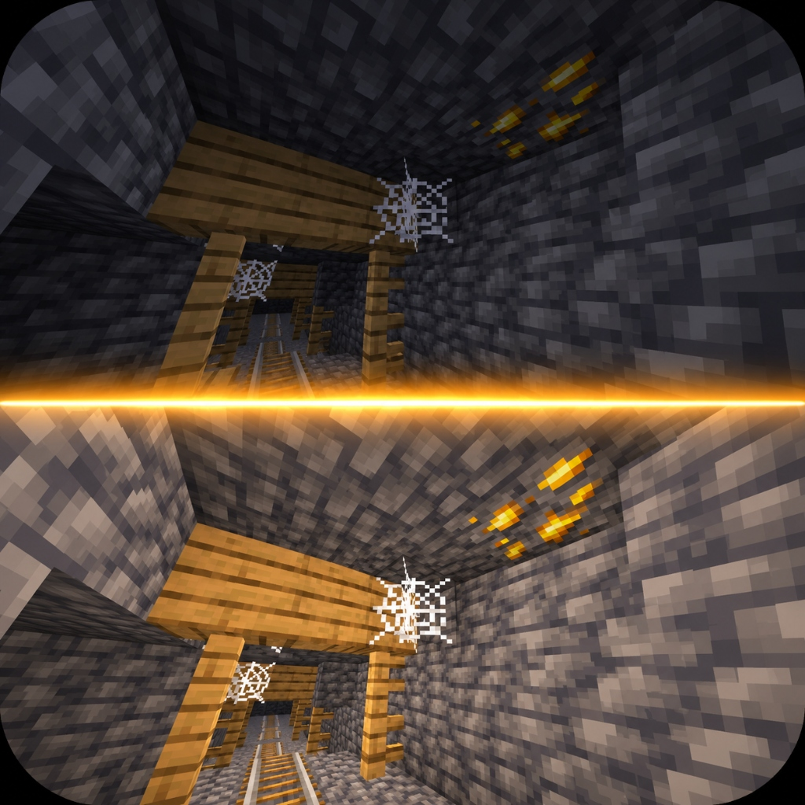
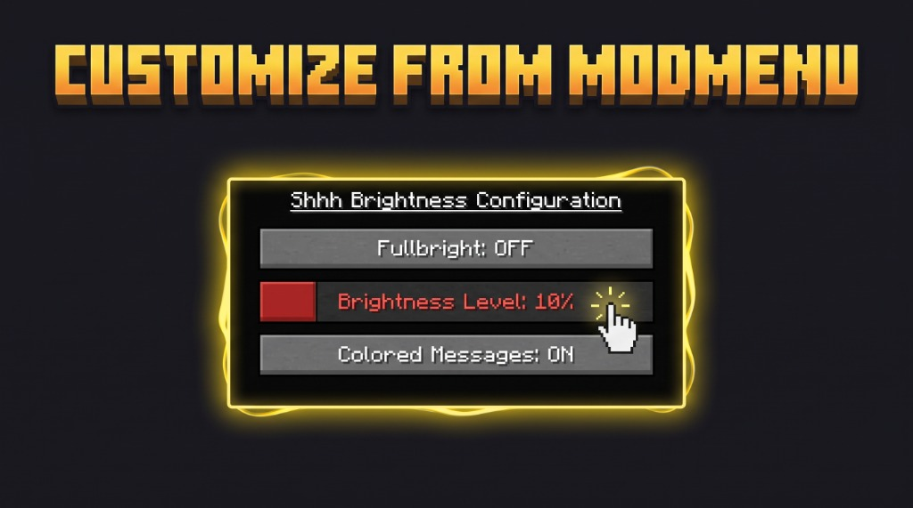
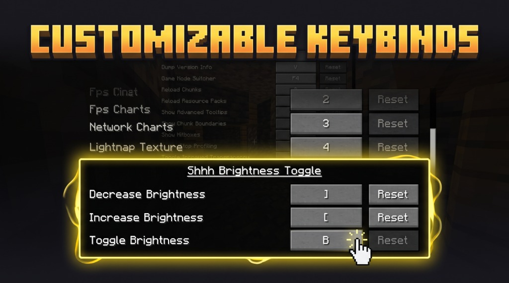

<div align="center">



# Shhh Brightness Toggle

**A simple client-side brightness and fullbright mod for Minecraft 26.2 on Fabric.**

[](https://minecraft.net/)
[](https://fabricmc.net/)
[](https://adoptium.net/)
[](LICENSE)
[](https://github.com/rafayshhh/shhh-brightness-toggle)

<br/>

*See clearly in caves, ravines, and underwater without potion bubbles or status icons.*

</div>

---

## Supported Versions

| Minecraft Version | Mod Loader | Status |
| :--- | :--- | :--- |
| 26.2 | Fabric | Released |

---

## Screenshots

### In-Game Visibility Comparison
See the difference in dark areas like abandoned mineshafts and caves:

<p align="center">
  
  <br/>
  <em>Side-by-side comparison: Default dark cave (left) vs. Brightness enabled at 100% (right).</em>
</p>

### Settings Screen (Mod Menu)
Adjust fullbright on or off, change the level with a slider, or toggle colored actionbar messages:

<p align="center">
  
  <br/>
  <em>In-game settings screen opened from Mod Menu.</em>
</p>

### Keybindings Menu
Rebind any of the hotkeys directly in your normal Minecraft controls:

<p align="center">
  
  <br/>
  <em>Hotkeys in Options -> Controls -> Key Binds under the Shhh Brightness Toggle category.</em>
</p>

---

## What the Mod Does

- **Toggle on and off with a key**: Press B (default) to turn brightness on or off whenever you need it.
- **Step brightness up and down**: Use the Up and Down arrow keys to adjust brightness between 10% and 100% in 10% steps.
- **Color-coded actionbar feedback**: When you change brightness, an on-screen message shows the current level. The text color shifts from red at low levels, to yellow at mid levels, to green at 100%. You can turn this off in settings if you prefer plain text.
- **No potion icons or particles**: Unlike older fullbright tricks that applied a fake Night Vision effect, this mod hooks directly into the lightmap rendering. That means no potion swirls on your screen and no potion icon in your inventory or HUD.
- **Remembers your normal brightness**: When you turn the mod off, leave a world, disconnect from a server, or close the game, your original vanilla brightness setting is restored automatically.
- **In-game config screen**: If you have Mod Menu installed, you get a clean settings screen with an on/off button, a slider, and a color toggle. Mod Menu is optional; the mod works fine without it.
- **Saves your settings**: Preferences are saved in your config folder and reload automatically next time you launch the game. If the config file ever gets corrupted or emptied, the mod resets to safe defaults without crashing.
- **Client-side only**: Everything runs on your computer. It sends no network packets to servers and does not need to be installed on any server you play on.

---

## Default Controls

You can rebind all three keys in **Options -> Controls -> Key Binds**:

| Action | Default Key | Category | What it does |
| :--- | :---: | :--- | :--- |
| **Toggle Brightness** | <kbd>B</kbd> | Shhh Brightness Toggle | Turns fullbright on or off |
| **Increase Brightness** | <kbd>↑</kbd> (Up Arrow) | Shhh Brightness Toggle | Increases brightness by 10% |
| **Decrease Brightness** | <kbd>↓</kbd> (Down Arrow) | Shhh Brightness Toggle | Decreases brightness by 10% |

---

## Requirements and Installation

### Requirements
- **Minecraft**: 26.2
- **Fabric Loader**: 0.20.1 or newer
- **Fabric API**: 0.161.0+26.2
- **Java**: 25 (bundled with modern Minecraft launchers)
- **Mod Menu**: (Optional) For the in-game settings screen

### How to Install
1. Make sure you have **[Fabric Loader](https://fabricmc.net/use/)** installed for Minecraft 26.2.
2. Download **[Fabric API](https://modrinth.com/mod/fabric-api)** and drop the `.jar` file into your `.minecraft/mods` folder.
3. Download `shhh-brightness-toggle-1.0.0+mc26.2.jar` from **[GitHub Releases](https://github.com/rafayshhh/shhh-brightness-toggle/releases)**, **[CurseForge](https://www.curseforge.com/minecraft/mc-mods/shhh-brightness-toggle)**, or **[Modrinth](https://modrinth.com/mod/shhh-brightness-toggle)** (pending review) and put it into `.minecraft/mods`.
4. (Optional) Put **[Mod Menu](https://modrinth.com/mod/modmenu)** into `.minecraft/mods` if you want to open the config screen in-game.

---

## Config File

Your settings are saved in `.minecraft/config/shhh-brightness-toggle.json`:

```json
{
  "enabled": true,
  "level": 1.0,
  "coloredText": true
}
```

- `enabled` (true / false): Whether fullbright is on when you load into a world.
- `level` (0.1 to 1.0): Brightness level from 10% to 100%.
- `coloredText` (true / false): Whether actionbar messages and the settings slider use color-coded text.

---

## Compatibility and Server Rules

- **Sodium and Iris**: The mod injects into Minecraft's lightmap rendering at the end of the method rather than replacing it. It is designed to work alongside Sodium and Iris, but has not yet been tested across every combination of lighting mods. If you notice any conflicts, please report them on GitHub.
- **Server Rules**: Some multiplayer servers consider fullbright an unfair advantage. Always check server rules before using this mod online. Use at your own risk.

---

## Updating Between Versions

This mod hooks into Minecraft's internal lightmap extractor (`LightmapRenderStateExtractor`). In future Minecraft updates, Mojang may change how internal lighting works. Each new Minecraft update will need to be checked, and a new mod version will be published if necessary.

---

## Building from Source

If you want to build the mod from source, use JDK 25. Set `JAVA_HOME` to your JDK 25 folder, then run `gradlew build` (Windows: `gradlew.bat build`).

**Windows (Command Prompt):**
```cmd
set "JAVA_HOME=C:\Path\To\Your\JDK-25"
gradlew.bat build
```

**Linux / macOS:**
```bash
export JAVA_HOME=/path/to/your/jdk-25
./gradlew build
```

The built JAR file will be located at:
`build/libs/shhh-brightness-toggle-1.0.0+mc26.2.jar`

---

## Support

Need help, have a question, or found a bug? Please open an issue on our [GitHub Issues](https://github.com/rafayshhh/shhh-brightness-toggle/issues) page.

---

## Bug Reports and Feedback

- Report bugs: [Open a Bug Report](https://github.com/rafayshhh/shhh-brightness-toggle/issues/new?template=bug_report.yml)
- Suggest features: [Open a Feature Request](https://github.com/rafayshhh/shhh-brightness-toggle/issues/new?template=feature_request.yml)
- Source code: [GitHub Repository](https://github.com/rafayshhh/shhh-brightness-toggle)

---

## Author and Credits

- **Created by**: **RafayShhh**
  - GitHub: [@rafayshhh](https://github.com/rafayshhh)
  - Modrinth: [RafayShhh](https://modrinth.com/user/RafayShhh)

---

## License

This project is open source and available under the [MIT License](LICENSE).
Not an official Minecraft product. Not approved by or associated with Mojang or Microsoft.
